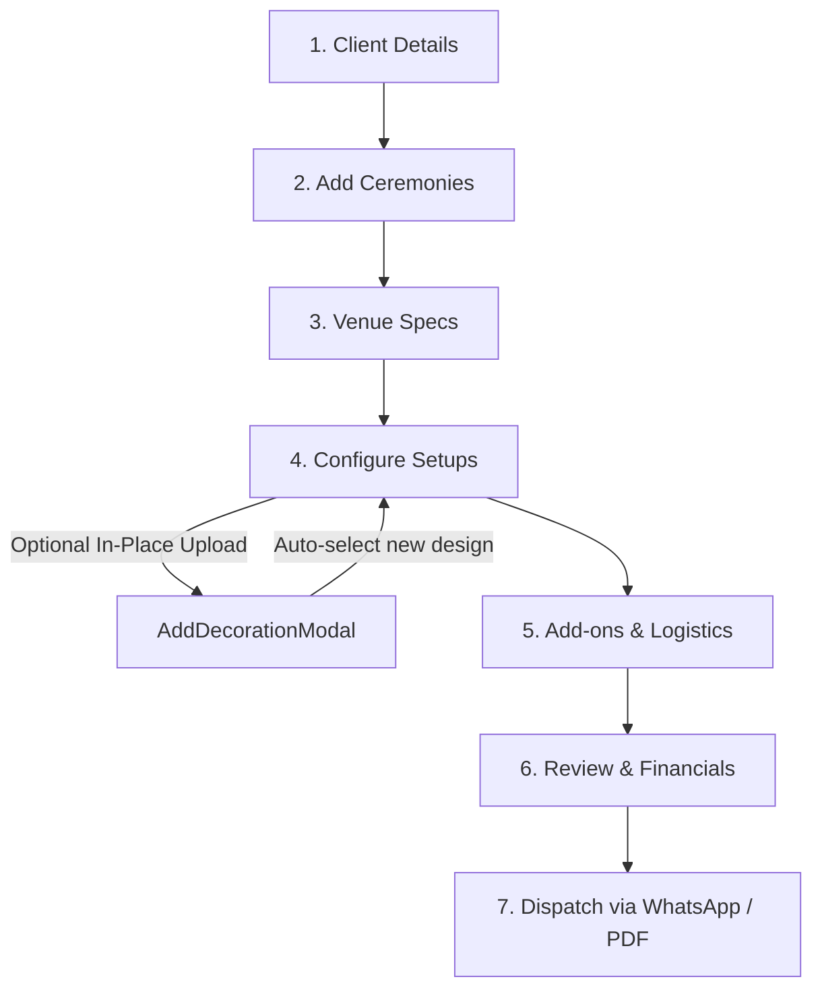

# 🌸 Decoration Portal & Business Management Suite

A modern, high-performance web application tailored specifically for wedding and event decoration businesses. It streamlines the end-to-end lifecycle of event planning—from initial client inquiries and dual-calendar scheduling (Nepali BS + AD), to multi-ceremony quotation generation, master design inventory management, and automated client dispatch.

---

## 📑 Table of Contents

1. [Overview & Purpose](#-overview--purpose)
2. [Key Capabilities & Features](#-key-capabilities--features)
3. [Architecture & Technology Stack](#-architecture--technology-stack)
4. [File & Directory Structure](#-file--directory-structure)
5. [Core Workflows](#-core-workflows)
   - [1. Multi-Ceremony Quotation Builder](#1-multi-ceremony-quotation-builder)
   - [2. Unified 3-Step "Add Decoration" Wizard](#2-unified-3-step-add-decoration-wizard)
   - [3. Master Catalog & Inventory Management](#3-master-catalog--inventory-management)
   - [4. Dual Calendar & Venue Logistics](#4-dual-calendar--venue-logistics)
6. [Data Model & Local Persistence](#-data-model--local-persistence)
7. [Getting Started & Local Setup](#-getting-started--local-setup)
8. [Available Scripts](#-available-scripts)

---

## 🌟 Overview & Purpose

Traditional event management suites are often generic or built exclusively for photography/venues. The **Decoration Portal** is customized around the real-world operational challenges of floral stylists, stage decorators, and mandap designers:

- **Complex Multi-Event Ceremonies**: Weddings typically consist of multiple distinct functions (e.g., _Mehendi_, _Sangeet_, _Haldi_, _Baraat / Wedding Ceremony_, _Reception_), each requiring unique setups, dimensions, floral tiers, and structure rigging.
- **Dynamic Decoration Design Catalog**: Maintain a rich visual portfolio of Stages, Mandaps, Entrance Gates, Backdrops, and Welcome Boards with live status controls (_Live_, _Paused_, _Draft_).
- **Dual Nepali (Bikram Sambat) & Gregorian (AD) Dates**: Built-in support for Nepalese wedding dates (e.g., _18 Ashwin 2083 BS_) alongside standard Gregorian calendar dates.
- **Instant Client Quotation Dispatch**: Live client-facing breakdown, instant PDF export, and direct WhatsApp quotation links.

---

## 🚀 Key Capabilities & Features

### 1. Executive Dashboard (`/company`)

- **Key Metrics Overview**: Real-time summary cards for Enquiries (Today, Yesterday, Month), Booked Clients, and Revenue.
- **Upcoming Functions**: Chronological list of confirmed events, assigned ceremonies, venues, and balance statuses.
- **Quick Action Bar**: Fast navigation to Date Check, Pending Quotations, Reminders, and Quotation Creation.
- **Recent Designs Showcase**: Interactive catalog cards with quick-toggle status pills and navigation to full inventory.

### 2. Multi-Step Quotation Generator (`/quotations/new`)

- **Step 1: Client Information**: Client name, phone, WhatsApp number, inquiry source, notes.
- **Step 2: Ceremony Schedule**: Add multiple ceremonies (Wedding, Reception, Sangeet, Haldi, etc.) with custom BS and AD dates, timings, and venue location.
- **Step 3: Venue & Requirements**: Venue classification (Majestic Grand, Hotel Ballroom, Outdoor Lawn), setup access hours, and technical constraints.
- **Step 4: Configure Event (Decoration Card Selection)**:
  - Multi-ceremony tabbed / sequential view.
  - Search designs by title, tags, and categories (_All_, _Stage_, _Mandap_, _Entrance Gate_, _Backdrop_, _Welcome Board_).
  - Filter by style (_With Flowers_ vs. _Structure Only_) and sorting (_Price: Low to High_, _Price: High to Low_, _Name_).
  - **In-Place Full-Screen "+ Upload Decoration"**: Allows decorators to upload brand-new setups on the fly without leaving the active quotation flow or losing state.
- **Step 5–6: Add-ons, Pricing & Completion**:
  - Live cost breakdown, discounts, tax/VAT toggles, and payment milestones (Advance, Mid-payment, Final).
  - Automated WhatsApp quotation link generator with formatted message templates.

### 3. Unified "Add Decoration" Wizard (`/add-decoration` & Modal)

A unified canonical 3-step design creator operating both as a dedicated route and as a full-screen overlay:

- **Step 1: Upload Photo**: Drag-and-drop file upload, local device browser, and curated inspiration library presets. Multi-photo support with cover photo selection.
- **Step 2: Basic Details**: Setup Title, Category, Applicable Events (Wedding, Reception, etc.), Main Structure selection (Truss, Floral Arch, Wooden Frame, Dome, etc.), and Styling tags.
- **Step 3: Setup Details**:
  - Dimensions (Width $\times$ Height in feet).
  - Floral Styling toggle (_With Flowers_ with flower row breakdowns vs. _Structure Only_).
  - Base / Starting Price with live formatted `Rs.` preview.
  - Platform / Mandap options (Shape, Fabric Color, Height, Add-on price).
  - Overall lighting items and fixtures breakdown.
  - Description textarea & Live Setup Summary card.

### 4. Master Inventory & Catalog (`/inventory`)

- Full grid and table views of all decoration items.
- Filter by category, status (_Live_, _Paused_, _Draft_), and floral usage.
- In-place status toggling via interactive dropdown pills.
- Edit existing designs, duplicate setups, or remove outdated entries.

---

## 🛠 Architecture & Technology Stack

| Layer                | Technology                                                                                      |
| :------------------- | :---------------------------------------------------------------------------------------------- |
| **Framework**        | [React 18](https://react.dev/) + [Vite](https://vitejs.dev/)                                    |
| **Language**         | [TypeScript](https://www.typescriptlang.org/) (Strict typing with `exactOptionalPropertyTypes`) |
| **Routing**          | [@tanstack/react-router](https://tanstack.com/router) (Type-safe client-side routing)           |
| **Styling**          | [Tailwind CSS](https://tailwindcss.com/) + Custom HSL Design Tokens                             |
| **UI Primitives**    | Radix UI (`@radix-ui/react-dialog`, `@radix-ui/react-dropdown-menu`, etc.)                      |
| **Icons**            | [Lucide React](https://lucide.dev/)                                                             |
| **Notifications**    | [Sonner](https://sonner.emilkowal.ski/)                                                         |
| **Data Persistence** | Custom Zustand-style reactive store syncing with browser `localStorage`                         |

---

## 📂 File & Directory Structure

```text
decoration-dashboard/
├── public/                     # Static assets and favicon
├── src/
│   ├── components/
│   │   ├── company/            # Primary business domain components
│   │   │   ├── add-decoration-page.tsx           # Unified 3-step setup creator (page & full-screen modal)
│   │   │   ├── company-dashboard.tsx             # Executive Home Dashboard (/company)
│   │   │   ├── multi-ceremony-card-selector.tsx  # Step 4 quotation card catalog selector
│   │   │   ├── decoration-catalog-card.tsx       # Reusable grid card with live status dropdown
│   │   │   ├── decoration-catalog-list-item.tsx  # Reusable list row item
│   │   │   ├── inventory-setup-page.tsx          # Master Catalog & Inventory screen
│   │   │   ├── flower-colour-input.tsx           # Floral styling palette and type picker
│   │   │   └── sidebar.tsx                       # Navigation sidebar with company identity
│   │   └── ui/                 # Core design system primitives (Button, Input, Dialog, etc.)
│   ├── lib/                    # Business utilities & state stores
│   │   ├── decoration-setups.ts# Master catalog store (useDecorationSetupsStore) & defaults
│   │   ├── company-profile.ts  # Company configuration & business info persistence
│   │   └── utils.ts            # Class name merging (clsx + tailwind-merge)
│   ├── routes/                 # TanStack file-based routes
│   │   ├── __root.tsx          # Root layout shell with navigation
│   │   ├── index.tsx           # Redirect to /company
│   │   ├── company.tsx         # Dashboard route
│   │   ├── inventory.tsx       # Inventory catalog route
│   │   ├── add-decoration.tsx  # Standalone Add/Edit decoration wizard route
│   │   └── quotations/         # Quotation management routes
│   │       ├── index.tsx       # Quotation listing
│   │       └── new.tsx         # Multi-step quotation creator
│   ├── App.tsx                 # Main Application component
│   ├── main.tsx                # React DOM entry point
│   └── index.css               # Global Tailwind CSS definitions & design tokens
├── package.json                # Project dependencies & scripts
├── tsconfig.json               # TypeScript compiler configuration
├── vite.config.ts              # Vite bundler configuration
└── README.md                   # Build mission documentation
```

---

## 🔄 Core Workflows

### 1. Unified 3-Step Wizard Flow


- Available at `/add-decoration` for standalone catalog management.
- Reused inside `MultiCeremonyCardSelector` as an edge-to-edge full-screen modal overlay via `AddDecorationModal`.
- On completion in quotation mode, saves directly into `useDecorationSetupsStore`, closes without page refresh, and automatically selects the newly created setup for the active ceremony.

### 2. Quotation Creation Flow



---

## 💾 Data Model & Local Persistence

The application uses reactive client stores backed by browser `localStorage`:

- **Key `decoration_setups_v1`**: Array of `DecorationSetupItem` objects.
  ```typescript
  interface DecorationSetupItem {
    id: string;
    sku: string;
    name: string;
    category: "Stage" | "Mandap" | "Entrance Gate" | "Backdrop" | "Welcome Board";
    imageUrl: string;
    gallery?: string[];
    description: string;
    applicable_events: string[];
    total_price: number;
    status?: "Live" | "Paused" | "Draft";
    floralTag?: "with_flowers" | "structure_only";
    specifications?: {
      dimensions?: { width_ft: number; height_ft: number };
      flowers_used?: boolean;
      flowers?: Array<{ name: string; colour: string; type: "natural" | "artificial" | "mixed" }>;
      platforms_used?: boolean;
      platform_shape?: string;
      platform_colour?: string;
      platform_price?: number;
      lighting_used?: boolean;
      overall_lighting_price?: number;
    };
  }
  ```
- **Key `decoration_company_profile`**: Stores active business credentials (name, phone, PAN/VAT, address, currency).

---

## 💻 Getting Started & Local Setup

### Prerequisites

- [Node.js](https://nodejs.org/) (v18.0.0 or higher) or [Bun](https://bun.sh/)
- `npm`, `pnpm`, or `bun` package manager

### Installation

1. Navigate to the project root directory:
   ```bash
   cd "decoration-dashboard"
   ```
2. Install project dependencies:
   ```bash
   npm install
   # or with bun:
   bun install
   ```
3. Start the local development server:
   ```bash
   npm run dev
   ```
4. Open your browser and navigate to:
   ```text
   http://localhost:5173
   ```

---

## 📜 Available Scripts

| Command            | Action                                                                 |
| :----------------- | :--------------------------------------------------------------------- |
| `npm run dev`      | Starts Vite dev server with hot module replacement (HMR)               |
| `npm run build`    | Compiles TypeScript and creates optimized production bundle in `dist/` |
| `npm run preview`  | Locally previews production build                                      |
| `npx tsc --noEmit` | Runs strict TypeScript type checking across the entire project         |
| `share-online.bat` | Helper script to tunnel the local dev server for mobile/client testing |

---

_Authored for the Decoration Business Suite — Designed for high-volume event production and client management._
