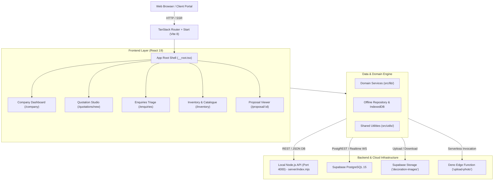
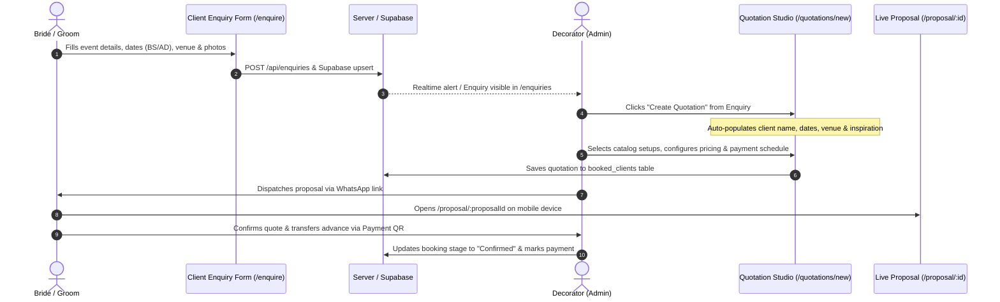

# 🌸 Decoration Portal: Comprehensive Developer & Technical Overview

This document provides an exhaustive, developer-focused architectural guide and technical reference for the **Decoration Web App** repository. It covers the system's purpose, design principles, technology stack, directory layout, core domain logic, end-to-end workflows, deployment lifecycle, and local development operations.

---

## 📑 Table of Contents

1. [Executive Summary & Purpose](#1-executive-summary--purpose)
2. [Architectural Principles & System Design](#2-architectural-principles--system-design)
3. [Technology Stack & Dependency Breakdown](#3-technology-stack--dependency-breakdown)
4. [Standardized Folder Structure & File Responsibilities](#4-standardized-folder-structure--file-responsibilities)
5. [Core Features & Domain Logic](#5-core-features--domain-logic)
6. [End-to-End Application Workflows](#6-end-to-end-application-workflows)
7. [Frontend / Backend Communication & Data Synchronization](#7-frontend--backend-communication--data-synchronization)
8. [Database Schema, Storage & Security](#8-database-schema-storage--security)
9. [Observability, Monitoring & Stress Testing](#9-observability-monitoring--stress-testing)
10. [Environment Variables & Configuration](#10-environment-variables--configuration)
11. [Build, Containerization & Deployment Process](#11-build-containerization--deployment-process)
12. [Step-by-Step Local Setup, Development & Testing Guide](#12-step-by-step-local-setup-development--testing-guide)
13. [Identified Gaps, Missing Configurations & Technical Debt](#13-identified-gaps-missing-configurations--technical-debt)

---

## 1. Executive Summary & Purpose

The **Decoration Portal** is a specialized ERP, quotation studio, and client presentation platform engineered specifically for wedding and event decoration businesses in South Asia (primarily Nepal).

Traditional generic CRM platforms and venue booking software fail to accommodate the unique operational nuances of stage decorators, mandap craftsmen, and floral stylists. This platform addresses three primary operational challenges:

1. **Complex Multi-Ceremony Event Structures**: A typical Hindu/Buddhist/Nepali wedding consists of 3 to 6 distinct functions over several days (e.g., *Mehendi*, *Sangeet*, *Haldi*, *Baraat / Biwaha Ceremony*, *Reception Party*). Each function takes place at different venues or halls, demands distinct structural setups (Roman arches, floral mandaps, photobooths), and follows discrete pricing and crew allocation models.
2. **Dual-Calendar Scheduling (Bikram Sambat BS + Gregorian AD)**: In Nepal, wedding auspicious dates (*Saahit*) are determined exclusively using the Bikram Sambat lunar/solar calendar (e.g., *15 Jestha 2083 BS*), whereas international clients, suppliers, and billing systems often rely on Gregorian dates (*29 May 2026 AD*). The system features bidirectional BS $\leftrightarrow$ AD date conversion, conflict detection, and calendar filtering.
3. **5-Block Componentized Pricing Breakdown**: Instead of arbitrary flat rates, large decoration setups are calculated using strict mathematical invariants:
   $$\text{Total Price} = \text{Base Structure} + \text{Platform} + \text{Lighting} + \text{Furniture} + \text{Add-ons}$$
4. **Live Interactive Client Proposals**: Generates branded, mobile-responsive client proposals (`/proposal/:proposalId`) featuring interactive design comparisons ("Can we build this inspiration?"), payment schedule milestones, automated WhatsApp dispatch links, and dynamic payment QR accounts.

---

## 2. Architectural Principles & System Design

The application uses a **hybrid full-stack architecture** built around modern type-safe standards:



### Architectural Layers

1. **Bootstrap Layer (`src/start.ts`, `src/server.ts`, `src/router.tsx`)**:
   - Manages application startup, TanStack Start client/server hooks, CSRF defense, and Nitro SSR entrypoints.
2. **Routing Layer (`src/routes/`)**:
   - Strictly typed, file-based routing with automatic code-splitting, route loaders, and SSR meta generation via `@tanstack/react-router`.
3. **Domain & Feature Layer (`src/components/company/`, `src/lib/`)**:
   - Encapsulates business logic, invariant checks, quotation calculations, and Supabase integration into self-contained modules. Presentation components never execute raw SQL or storage mutations directly.
4. **Shared Primitives Layer (`src/components/ui/`, `src/utils/`, `src/styles.css`)**:
   - Reusable Radix UI headless primitives wrapped with Tailwind CSS 4 tokens, accessible focus states, and consistent typography (`Cormorant Garamond` serif and `DM Sans` sans-serif).
5. **Standalone API Server Layer (`server/index.mjs`)**:
   - Zero-dependency Node.js HTTP microservice providing local data persistence (`server/data/db.json`), automated rolling `.bak` backups, Prometheus `/api/metrics`, and `/api/health`.
6. **Cloud & Edge Layer (`supabase/`)**:
   - Cloud PostgreSQL schema, Row-Level Security policies, Realtime websocket broadcasting, and Deno TypeScript edge functions.

---

## 3. Technology Stack & Dependency Breakdown

### Runtime & Core Frameworks

| Layer | Technology | Version | Purpose in Codebase |
|---|---|---|---|
| **Language** | TypeScript | `^5.8.3` | Strict type-safety across all routes, models, and tests. |
| **Runtime** | Node.js / Bun | Node `20+`, Bun `1.2.4+` | Fast package management, local script execution, and test running. |
| **Frontend Library** | React | `^19.2.0` | React 19 concurrent features, transitions, and component trees. |
| **Routing** | TanStack Router | `1.170.18` | Full type-safe file-based routing and search parameter validation. |
| **SSR / Hydration** | TanStack Start | `1.168.32` | Isomorphic server-side rendering and client hydration. |
| **SSR Engine** | Nitro | `3.0.260603-beta` | High-performance server engine compiling Vite into SSR bundles. |
| **Bundler** | Vite | `8.1.5` | Instant HMR development server and optimized Rollup production packaging. |

### Styling & UI Primitives

| Library | Version | Usage |
|---|---|---|
| **Tailwind CSS** | `^4.2.1` | Modern `@tailwindcss/vite` CSS compiler without legacy PostCSS overhead. |
| **Radix UI** | Various `^1.1` - `^2.2` | Accessible headless primitives: Dialog, Popover, Select, Dropdown, Accordion, Tooltip. |
| **Class Utilities** | `clsx` (`2.1.1`), `tailwind-merge` (`3.5.0`) | Dynamic conditional class merging encapsulated in `src/utils/cn.ts`. |
| **Icons** | `lucide-react` (`^0.575.0`) | Complete SVG icon library. |
| **Notifications** | `sonner` (`^2.0.7`) | Toast notifications for async saves, status updates, and copy actions. |

### Domain Utilities & Localization

| Library | Version | Purpose |
|---|---|---|
| **`nepali-date-converter`** | `^3.4.0` | Bidirectional Bikram Sambat (BS) $\leftrightarrow$ Gregorian (AD) date conversions. |
| **`date-fns`** | `^4.1.0` | Modern date manipulation, parsing, and arithmetic. |
| **`zod`** | `^3.25.76` | Runtime payload parsing and schema validation. |
| **`react-hook-form`** | `^7.71.2` | High-performance uncontrolled form state management. |

### Database, Cloud & Edge

| Library / Tool | Version | Usage |
|---|---|---|
| **`@supabase/supabase-js`** | `^2.117.3` | Supabase client for PostgREST CRUD, Realtime channels, and storage buckets. |
| **`pg`** | `^8.23.1` | Node-postgres driver used in direct DB migration scripts. |
| **Supabase Edge Functions** | Deno runtime | Serverless photo validation and upload pipeline (`upload-photo`). |

---

## 4. Standardized Folder Structure & File Responsibilities

```
decoration-web-app/
├── .agents/                    # Multi-agent guardrail security hooks and rules
│   ├── hooks/
│   │   ├── guard.py            # Fail-closed Python guardrail inspecting all agent tool calls
│   │   └── test_guard.py       # 96-case verification test suite for guardrails
│   └── hooks.json              # Hook registration configuration
├── .claude/                    # Claude Code & IDE configuration
│   ├── launch.json             # Multi-target debugger launcher (API, Web, Client)
│   └── settings.json           # Permissions allow/deny/ask policies
├── docker/                     # Cross-platform containerization
│   ├── Dockerfile              # Multi-stage build (base, dev, builder, production)
│   ├── docker-compose.yml      # Orchestrates web dashboard (5174) and API server (4000)
│   └── README.md               # Container deployment manual
├── docs/                       # Project documentation
│   ├── architecture.md         # Modular architecture and layer breakdown
│   ├── DECORATION-PROJECT.md   # Domain requirements and business spec
│   ├── load-testing.md         # k6 benchmarking manual and latency thresholds
│   ├── observability.md        # Prometheus metrics & Grafana dashboard guide
│   ├── PROJECT.md              # Feature inventory and catalog guide
│   └── PROJECT_OVERVIEW.md     # This comprehensive developer reference
├── public/                     # Static assets served without Vite processing
│   ├── assets/                 # Public static image files
│   ├── favicon.ico
│   └── robots.txt
├── scripts/                    # Operational and validation scripts
│   ├── load-test.js            # k6 automated load test suite
│   ├── migrate-supabase.mjs    # Node script for direct PostgreSQL schema migration
│   ├── test-grand-royal-stage.mjs  # Asserts 5-block pricing math in server database
│   ├── test-proposal-layout-order.mjs # Verifies proposal visual layout order
│   ├── test-quotation-empty-fix.mjs  # Verifies quotation data healing
│   └── test-repository-logic.mjs     # Tests local storage auto-recovery and backups
├── server/                     # Standalone API & Metrics Server
│   ├── data/
│   │   ├── db.json             # Local JSON document database
│   │   └── uploads/            # Local image upload directory
│   └── index.mjs               # Node HTTP server: /api/health, /api/metrics, /api/decorations
├── src/                        # Primary Application Source Code
│   ├── assets/                 # Bundled graphics, icons, and image placeholders
│   ├── components/
│   │   ├── company/            # Domain-specific UI features
│   │   │   ├── booked-clients-page.tsx       # Booking timeline & payment balances
│   │   │   ├── client-enquiry-form.tsx       # Public lead generation form
│   │   │   ├── company-dashboard.tsx         # Executive dashboard & metrics
│   │   │   ├── company-picker.tsx            # Multi-tenant company selector
│   │   │   ├── decoration-catalog-card.tsx   # Interactive catalog card with status pills
│   │   │   ├── decoration-details-modal.tsx  # Full-screen setup inspection dialog
│   │   │   ├── decoration-proposal-view.tsx  # Public client proposal viewer
│   │   │   ├── enquiries-triage-page.tsx     # Lead pipeline & status triage
│   │   │   ├── inventory-setup-page.tsx      # Master inventory catalog manager
│   │   │   ├── profile-setup.tsx             # Company onboarding wizard
│   │   │   └── quotation-studio-page.tsx     # 6-step multi-ceremony quote builder
│   │   └── ui/                 # 40+ Headless Radix UI design tokens
│   ├── hooks/                  # Shared React hooks (e.g. use-mobile.tsx)
│   ├── lib/                    # Domain logic, data stores, and integrations
│   │   ├── clients.ts          # Booked clients conversion, status, and calculations
│   │   ├── company-profile.ts  # Multi-company active scope, local storage, profile models
│   │   ├── current-company.ts  # Fallback preset companies (Gulab, Royal Orchid)
│   │   ├── decor-item-breakdown.ts # 5-block pricing calculation and spec synthesis
│   │   ├── decoration-setups.ts# Master decoration catalog store, filters, and seeds
│   │   ├── enquiries.ts        # Enquiry data models, status lifecycle, and validators
│   │   ├── enquiry-repository.ts # Local persistence with rolling backup and auto-recovery
│   │   ├── enquiry-sync.ts     # Realtime synchronizer and conflict resolver
│   │   ├── event-schedule.ts   # BS/AD calendar conversion logic
│   │   ├── image-storage.ts    # Canvas WebP compressor and Supabase Storage uploader
│   │   ├── supabase-service.ts # Remote PostgREST CRUD & Realtime channels
│   │   ├── supabase.ts         # Supabase client factory
│   │   └── utils.ts            # Backward-compatible re-exporter from src/utils/
│   ├── routes/                 # TanStack Start file-based route definitions
│   │   ├── __root.tsx          # Global document shell, HTML head, fonts, toaster
│   │   ├── index.tsx           # Smart redirect to /company or /companies
│   │   ├── companies.tsx       # Company selection route
│   │   ├── setup.tsx           # New company onboarding route
│   │   ├── company.tsx         # Executive dashboard route
│   │   ├── enquiries.tsx       # Lead triage route
│   │   ├── enquire.tsx         # Public enquiry submission route
│   │   ├── inventory.tsx       # Inventory catalog route
│   │   ├── add-decoration.tsx  # 3-step design creator route
│   │   ├── quotations.new.tsx  # Quotation Studio generator route
│   │   ├── proposal.$proposalId.tsx # Public proposal route
│   │   ├── booked-clients.tsx  # Booked clients route
│   │   └── settings.tsx        # Settings & Payment QR route
│   ├── utils/                  # Centralized, pure utility helpers
│   │   ├── cn.ts               # Tailwind class merger
│   │   ├── formatters.ts       # Nepali currency (NPR), phone, and title formatters
│   │   ├── index.ts            # Central utility barrel exporter
│   │   └── validators.ts       # Email, phone, and file validators
│   ├── routeTree.gen.ts        # Auto-generated type-safe route tree
│   ├── router.tsx              # Router instantiation
│   ├── server.ts               # Nitro SSR entrypoint & error boundary wrapper
│   ├── start.ts                # TanStack Start isomorphic bootstrap
│   └── styles.css              # Design tokens and Tailwind utility layers
├── supabase/                   # Supabase local environment & migrations
│   ├── functions/              # Deno Edge Functions
│   │   └── upload-photo/       # Validates and uploads photos to Storage
│   ├── migrations/             # Timestamped SQL migrations
│   │   ├── 20261012000000_init_schema.sql # Core tables, indexes, and RLS
│   │   └── 20261012000001_storage.sql     # Storage bucket and column updates
│   ├── seed/                   # Database seed files
│   │   └── seed.sql            # Rich test data for companies, setups, enquiries
│   ├── tests/                  # pgTAP database unit tests
│   │   └── database.test.sql   # Tests tables, columns, and bucket presence
│   ├── baseline.json           # Schema baseline descriptor
│   ├── config.toml             # Local Supabase CLI configuration
│   └── seed.sql                # Entrypoint for `supabase db reset`
├── tests/                      # Dedicated project test suites
│   ├── unit/                   # Pure function and formatting unit tests
│   │   └── formatters.test.ts  # Validates currency grouping and validators
│   └── README.md
├── .dockerignore
├── AGENTS.md                   # Instructions and security guardrail constraints
├── bun.lock                    # Bun dependency lockfile
├── bunfig.toml                 # Bun execution configuration
├── package.json                # Project dependencies, scripts, and overrides
├── README.md                   # Root README
├── tsconfig.json               # TypeScript strict compilation settings
└── vite.config.ts              # Vite & TanStack Start build configuration
```

---

## 5. Core Features & Domain Logic

### 5.1 Multi-Tenant Company Scoping (`/companies`, `/setup`, `src/lib/company-profile.ts`)
- **Concept**: The app allows different decoration companies (e.g., *Gulab Decor*, *Royal Orchid Events*, *Grand Celebrations*) to use the same portal on shared or distinct browsers.
- **Active Company State**: Tracked via `localStorage` key `decoration-portal:active-company`.
- **Database Row Mapping**: The first company uses row ID `'default'`; subsequent companies use generated IDs like `'company-xyz'`.
- **Shared vs Scoped Data**:
  - Enquiries and Quotations are **strictly scoped** by `company_id`.
  - The Decoration Catalog allows **cross-company inspiration**: decorators can view other companies' designs in read-only mode to find suitable matches when a client uploads an external photo.

### 5.2 Multi-Ceremony Quotation Studio (`/quotations/new`)
The quotation studio guides decorators through a 6-step configuration process:
1. **Client Identity**: Captures client name, mobile phone, WhatsApp number, inquiry source, and private notes.
2. **Ceremony Schedule**: Supports multiple ceremonies (e.g., Wedding + Reception). Each ceremony specifies date in both **BS** and **AD**, time slot, and venue.
3. **Venue & Constraints**: Selects venue scale (Hotel Ballroom, Resort Lawn, Banquet Hall) and setup access hours.
4. **Design Selection & Inspiration Matching**:
   - Decorators browse their catalog or upload a brand-new setup in-place without losing quotation progress.
   - **Inspiration Matching ("Can we build this?")**: If a client provides an external photo, the decorator marks it as *Exact Match* or *Similar Design*, linking a catalog item or quoting an ad-hoc custom rate.
5. **Add-ons & Milestones**: Configure platform upgrades, additional ambient lighting fixtures, sound/truss add-ons, and payment milestone splits (e.g., 30% advance, 50% on setup day, 20% on completion).
6. **Completion & WhatsApp Dispatch**: Generates formatted proposal links and deep-links directly into WhatsApp Web/Mobile with pre-filled event summaries.

### 5.3 5-Block Pricing Calculation Engine (`src/lib/decor-item-breakdown.ts`)
Every decoration item maintains mathematical consistency:

$$\text{Item Total} = \text{Base Price} + \text{Platform Price} + \text{Lighting Price} + \text{Furniture Price} + \text{Add-ons}$$

- **Specification Formatting**: Formats dimensions (e.g., `24 × 14 ft`), structure types (e.g., `Roman Arch Truss`), and floral tier notes.
- **Digit Grouping**: Implements Nepali/Indian numbering conventions (`1,40,000` instead of Western `140,000`) via `formatNepaliNumber()` and `formatNpr()`.
- **Invariants**: Unit test `src/lib/decor-item-breakdown.test.ts` validates that no pricing formula ever drifts from this sum.

### 5.4 Unified 3-Step "Add Decoration" Wizard (`/add-decoration`)
- Can be launched as a full-page route or an overlay modal from within the Quotation Studio.
- **Step 1: Upload Photos**: Drag-and-drop support with client-side canvas compression (`compressToBlob` in `src/lib/image-storage.ts`) converting high-resolution files to lightweight WebP (max 1000px, 0.6 quality).
- **Step 2: Basic Details**: Title, category (Stage, Mandap, Photobooth, Entrance Gate, Backdrop), structure material, and styling tags.
- **Step 3: Setup Breakdown**: Width/height, platform dimensions, lighting fixtures, furniture options, and live setup summary card.

### 5.5 Dual BS / AD Calendar Engine (`src/lib/event-schedule.ts`)
- Leverages `nepali-date-converter` to compute Nepalese year, month, and day for any Gregorian date and vice-versa.
- Formats dates into human-friendly strings (e.g., *15 Jestha 2083 BS / 29 May 2026 AD*).
- Validates date conflicts against existing confirmed bookings for the same date and venue.

### 5.6 Interactive Client Proposal Viewer (`/proposal/:proposalId`)
- Public, mobile-optimized view designed for brides, grooms, and event hosts.
- Visual hierarchy verified by tests:
  1. **Event Schedule**: Chronological ceremony cards with venue and timings.
  2. **WHAT WE WILL BUILD**: High-resolution gallery of selected designs, inclusions list, style tags, and dimension badges.
  3. **TOTAL QUOTATION**: Detailed financial breakdown, package descriptions, milestone payment schedule, and terms & conditions toggle.
  4. **FIND US ONLINE**: Company social links (Instagram, Facebook) and contact cards.
  5. **Payment Integration**: Displays bank QR accounts uploaded in Company Settings.

---

## 6. End-to-End Application Workflows

### Workflow 1: New Client Lead to Confirmed Booking



### Workflow 2: Adding a Setup to the Master Inventory

1. Decorator navigates to `/inventory` and clicks **"+ Add Decoration"**.
2. Uploads photos $\rightarrow$ `image-storage.ts` compresses image into WebP format $\rightarrow$ uploads to Supabase Storage bucket `decoration-images`.
3. Decorator enters dimensions (`24x14 ft`), picks inclusions (Roman Arch, Velvet Carpet), selects platform and lighting fixtures.
4. System calculates base + component breakdown $\rightarrow$ writes to `public.decorations` in Supabase and local cache.
5. The new setup is immediately available in the live Quotation Studio selector.

---

## 7. Frontend / Backend Communication & Data Synchronization

The application implements a **robust offline-first, dual-persistence model**:

```
User Action (Edit / Save)
    │
    ├── 1. Memory / UI State (Immediate optimistic update via React State)
    │
    ├── 2. Local Storage / IndexedDB (Instant offline persistence with rolling backups)
    │
    ├── 3. Standalone Node API (PUT/POST http://localhost:4000/api/...)
    │
    └── 4. Cloud Supabase (PostgREST HTTPS upsert + Storage + Realtime WS broadcast)
```

### 1. Standalone HTTP Server (`server/index.mjs`)
- Runs on port `4000` (or `process.env.API_PORT`).
- Stores data in `server/data/db.json` with automatic `.bak` backups.
- Does not require any external database to run locally; serves as a lightweight alternative when Supabase is unreachable.

### 2. Cloud Supabase Integration (`src/lib/supabase-service.ts`)
- Talks to Supabase using `@supabase/supabase-js`.
- All tables enforce `onConflict: "id"` upsert logic to guarantee idempotency.
- **Realtime Synchronization**: `createTableRealtime()` maintains persistent Supabase Realtime channels. If another team member modifies an enquiry or decoration, the change broadcasts via websockets and updates all active dashboards.

### 3. Image Storage Pipeline (`src/lib/image-storage.ts` & Edge Function)
- Client-side canvas compression ensures uploaded photos are compressed to under 500KB before network transmission.
- Files are saved with deterministic SHA-1 hashes to prevent duplicate uploads.
- The dedicated Supabase Edge Function (`supabase/functions/upload-photo/index.ts`) allows backend validation of MIME types, sizes, and direct uploads.

---

## 8. Database Schema, Storage & Security

The database runs on **PostgreSQL 15** inside Supabase:

### Database Tables Breakdown

```sql
-- 1. Decorations Catalog
public.decorations (
  id TEXT PRIMARY KEY,
  sku TEXT,
  name TEXT NOT NULL,
  category TEXT NOT NULL,           -- Stage, Mandap, Photobooth, Entrance Gate, Backdrop
  price NUMERIC NOT NULL DEFAULT 0,
  status TEXT NOT NULL DEFAULT 'Live', -- Live, Paused, Draft
  company_id TEXT,
  company_name TEXT,
  image_url TEXT,
  dimensions JSONB DEFAULT '{}',     -- { width, height, depth }
  specifications JSONB DEFAULT '{}', -- { inclusions, colours, style, priceUnit }
  components JSONB DEFAULT '[]',     -- 5-block pricing array
  created_at TIMESTAMPTZ DEFAULT now()
);

-- 2. Client Enquiries
public.enquiries (
  id TEXT PRIMARY KEY,
  client_name TEXT NOT NULL,
  phone TEXT NOT NULL,
  whatsapp_number TEXT,
  email TEXT,
  location TEXT,
  ceremony_type TEXT,
  date_bs TEXT,
  date_ad TEXT,
  venue TEXT,
  status TEXT NOT NULL DEFAULT 'unreviewed', -- unreviewed, in-discussion, quotation-sent, confirmed, declined
  estimated_budget_npr NUMERIC,
  assigned_handler TEXT,
  events JSONB NOT NULL DEFAULT '[]',
  reference_images JSONB DEFAULT '[]',
  created_at TIMESTAMPTZ DEFAULT now()
);

-- 3. Booked Clients & Quotations
public.booked_clients (
  id TEXT PRIMARY KEY,
  client_name TEXT NOT NULL,
  phone TEXT,
  event_type TEXT,
  event_date TEXT,
  venue TEXT,
  stage TEXT NOT NULL DEFAULT 'confirmed', -- enquiry, quote_sent, confirmed, completed, cancelled
  payment_status TEXT DEFAULT 'balance_due',
  total_amount NUMERIC NOT NULL DEFAULT 0,
  paid_amount NUMERIC NOT NULL DEFAULT 0,
  balance_due NUMERIC NOT NULL DEFAULT 0,
  proposal_id TEXT UNIQUE,
  enquiry_id TEXT,
  company_id TEXT,
  ceremonies JSONB NOT NULL DEFAULT '[]',  -- Contains all quotation ceremony items & designs
  payment_accounts JSONB DEFAULT '[]'
);

-- 4. Company Profiles
public.company_profile (
  id TEXT PRIMARY KEY DEFAULT 'default',
  name TEXT NOT NULL,
  owner_name TEXT,
  phone TEXT,
  email TEXT,
  city TEXT,
  services JSONB DEFAULT '[]',
  event_types JSONB DEFAULT '[]',
  team_size TEXT,
  years_active TEXT,
  about TEXT,
  updated_at TIMESTAMPTZ DEFAULT now()
);

-- 5. Payment QR Accounts
public.payment_qrs (
  id TEXT PRIMARY KEY,
  owner_name TEXT NOT NULL,
  label TEXT NOT NULL,              -- e.g. "Nabil Bank Business Account"
  account_number TEXT,
  image TEXT NOT NULL,              -- Base64 or Storage URL of QR graphic
  display_order INTEGER DEFAULT 0
);
```

### Storage Buckets & Policies
- **Bucket**: `decoration-images` (Public).
- **Policies**: Configured in [supabase/migrations/20261012000001_storage.sql](file:///Users/xito/Desktop/worksuvash/decoration-web-app/supabase/migrations/20261012000001_storage.sql) allowing public read access and authenticated/anon uploads.

### Security Guardrails (`.agents/hooks/guard.py` & `.claude/settings.json`)
The repository includes an autonomous agent security hook:
- **Blocked Operations**: `rm -rf`, `find -delete`, raw `DROP TABLE`, destructive `DELETE FROM`, direct database mutations (`psql`, `redis-cli`), uncontrolled git pushes (`git push`, `git reset --hard`), and reading/leaking `.env` secrets.
- **Fail-Closed Architecture**: Any error in the guard script automatically exits with code `2`, blocking tool execution until explicitly approved.
- Verified by automated test: `python3 .agents/hooks/test_guard.py` (75 blocked, 21 allowed).

---

## 9. Observability, Monitoring & Stress Testing

The API server (`server/index.mjs`) embeds enterprise observability:

### 1. System Health (`GET /api/health`)
Returns live JSON diagnostics:
```json
{
  "status": "ok",
  "timestamp": "2026-10-17T07:27:46.088Z",
  "uptimeSeconds": 1420,
  "database": {
    "decorationsCount": 18,
    "enquiriesCount": 42,
    "connected": true
  },
  "system": {
    "memoryRssBytes": 20482952,
    "heapUsedBytes": 8709408,
    "heapTotalBytes": 11157504
  }
}
```

### 2. Prometheus Metrics (`GET /api/metrics`)
Standard OpenMetrics format scrapable by Prometheus servers:
- `decoration_uptime_seconds` (Gauge)
- `decoration_requests_total` (Counter)
- `decoration_items_total` (Gauge)
- `decoration_enquiries_total` (Gauge)
- `decoration_memory_bytes{type="rss|heapTotal|heapUsed"}` (Gauge)
- `decoration_http_requests{method="GET|POST",path="/api/..."}` (Counter per route)

### 3. Load Testing with k6 (`scripts/load-test.js`)
Configured to stress-test concurrent traffic:
- **Stage Profile**: 10s ramp to 10 VUs $\rightarrow$ 30s steady load at 30 VUs $\rightarrow$ 10s spike to 50 VUs $\rightarrow$ 10s ramp down.
- **Pass Criteria**: $p(95)$ latency $< 300\text{ ms}$, HTTP failure rate $< 1\%$.
- Execute with: `npm run test:load`.

---

## 10. Environment Variables & Configuration

All environment variables are loaded via Vite (`import.meta.env`) or Node (`process.env`). They are defined in `.env`:

| Variable Name | Required | Default | Description |
|---|---|---|---|
| `VITE_SUPABASE_URL` | **Yes** | — | HTTPS endpoint of the Supabase project (e.g. `https://<your-project-id>.supabase.co`). |
| `VITE_SUPABASE_ANON_KEY` | **Yes** | — | Public anonymous API key used by browser to query PostgREST and Storage. |
| `API_PORT` | No | `4000` | Port for the standalone local Node API server. |
| `PORT` | No | `5174` | Port for the Vite development server. |
| `NODE_ENV` | No | `development` | Target environment mode (`development`, `production`, `test`). |
| `TARGET_URL` | No | `http://localhost:4000` | Target URL used by the k6 load testing suite. |
| `DB_HOST`, `DB_PASSWORD` | No | — | Optional direct PostgreSQL credentials used by `scripts/migrate-supabase.mjs`. |

> [!CAUTION]
> Never commit actual `.env` files with private credentials to public version control. The repository ignores `.env` and `.env.*.local` files via `.gitignore` and `.dockerignore`.

---

## 11. Build, Containerization & Deployment Process

### 1. Build Compilation
Running `bun run build` (or `npm run build`):
1. **Vite Client Pass**: Compiles React 19 JSX, transforms Tailwind 4 CSS, and outputs static assets to `.output/public/`.
2. **Nitro Server Pass**: Compiles TanStack Start SSR handlers, route manifests, and router trees into a unified server bundle at `.output/server/index.mjs` in ~250ms.

### 2. Multi-Stage Docker Container (`docker/Dockerfile`)
The Docker container supports cross-platform execution on macOS (arm64), Linux (amd64/arm64), and Windows (WSL2):
- **Stage 1 (`base`)**: Node 20 Alpine with Bun installed.
- **Stage 2 (`development`)**: Mounts local volume for live code reload (`bun run dev`).
- **Stage 3 (`builder`)**: Executes production build.
- **Stage 4 (`production`)**: Standalone minimal runtime running both the API server (port 4000) and the Nitro SSR bundle (port 5174) with automated Docker health checks.

---

## 12. Step-by-Step Local Setup, Development & Testing Guide

### Prerequisites
- **Node.js**: `v20.0.0` or higher (Node 22 recommended)
- **Bun**: `v1.2.0` or higher (optional, but recommended for speed)
- **Git**: Installed and configured

---

### Step 1: Install Dependencies
```bash
# Using Bun (recommended)
bun install

# Or using standard npm
npm install
```

---

### Step 2: Configure Environment
Create a `.env` file at the project root:
```env
VITE_SUPABASE_URL=https://<your-project-id>.supabase.co
VITE_SUPABASE_ANON_KEY=your-anon-key-here
API_PORT=4000
PORT=5174
```

---

### Step 3: Run the Application Locally

#### Option A: Run Both Frontend & Backend in One Command
```bash
npm run api & npm run dev
```

#### Option B: Run in Separate Terminals
- **Terminal 1 (Backend API & Health Metrics)**:
  ```bash
  npm run api
  ```
  *Runs on [http://localhost:4000](http://localhost:4000)*
- **Terminal 2 (Web Dashboard & Quotation Studio)**:
  ```bash
  npm run dev
  ```
  *Runs on [http://localhost:5174](http://localhost:5174)*

#### Option C: Run with Docker
```bash
docker compose -f docker/docker-compose.yml up --build
```

---

### Step 4: Run the Complete Test Harness

```bash
# Runs all 5 test suites (Repository, Layout Order, Quotation Healing, Catalog Math, Unit Tests):
npm test

# Run ESLint check without warnings:
bun run lint --quiet

# Run Agent Guardrail self-test:
python3 .agents/hooks/test_guard.py

# Run k6 Stress Test (requires k6 installed):
npm run test:load
```

---

### Step 5: Build for Production
```bash
npm run build
npm run preview
```

---

## 13. Identified Gaps, Missing Configurations & Technical Debt

This section documents current operational constraints and recommended next steps based on analysis of the active codebase:

1. **Remote Supabase Database Tables Pending**:
   - *Status*: The project is connected to the remote Supabase project configured in `.env`, but the remote database instance has not yet had the schema migrations executed.
   - *Fix*: The user must execute [supabase/migrations/20261012000000_init_schema.sql](file:///Users/xito/Desktop/worksuvash/decoration-web-app/supabase/migrations/20261012000000_init_schema.sql) and [supabase/migrations/20261012000001_storage.sql](file:///Users/xito/Desktop/worksuvash/decoration-web-app/supabase/migrations/20261012000001_storage.sql) in their Supabase Dashboard SQL Editor so that the `company_profile`, `decorations`, `enquiries`, and `booked_clients` tables exist to persist data.
2. **Simplified Multi-Company Authentication**:
   - *Status*: Company switching currently operates in "testing stage" mode (`CompanyPicker`). Users select their company from a list without password or OAuth authentication.
   - *Next Step*: Implement Supabase Auth (`supabase.auth.signUp()`, `signInWithPassword()`) and bind company IDs to `auth.users.id` via Row Level Security (RLS) policies when moving to strict multi-tenant production.
3. **Storage Bucket Provisioning**:
   - *Status*: The client-side code assumes the storage bucket `decoration-images` is public and accessible.
   - *Next Step*: Verify that the bucket is initialized in Supabase Storage or run migration `20261012000001_storage.sql`.
4. **Client Panel Dependency**:
   - *Status*: `.claude/launch.json` contains a configuration targeting `../client panel`, which is outside the current workspace repository. If the public client site is separated into its own repository, configure shared CORS and API endpoints accordingly.
